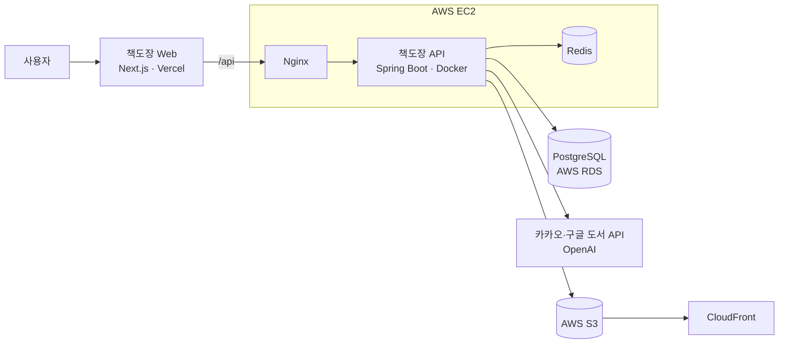

<div align="center">

# 📚 책도장 API

**독서 기록 SNS [책도장](https://www.chaekdojang.com)의 백엔드 서버**


[서비스 바로가기](https://www.chaekdojang.com) · [프론트엔드 저장소](https://github.com/hyesug/chaekdojang-frontend)

</div>

## 📖 소개

책도장은 읽은 책을 독후감으로 기록하고 다른 독자와 나누는 독서 SNS입니다. 이 저장소는 웹 서비스가 사용하는 REST API 서버입니다.

## ✨ 주요 기능

| 기능 | 설명 |
| --- | --- |
| 회원 | 카카오·네이버·구글 소셜 로그인, JWT 인증, 팔로우 |
| 독후감 | 작성·수정·삭제, 공개 범위·예약 공개, 피드, 좋아요·댓글·북마크 |
| AI 도우미 | AI 독서카드, 도장 코멘트(독후감 피드백), 다시 읽기 질문 |
| 책 | 카카오·구글 도서 검색, 웹소설 정보, 구매 링크 |
| 서재 | 내 서재, 독서 목표, 독서 통계 |
| 독서모임 | 모임 만들기·가입·초대, 함께 읽는 책, 질문·답변 |
| 도장단 (베타) | 서평단 모집·신청·선정, 워터마크를 넣은 PDF 열람 |
| 공모전 | 독후감 공모전 응모, 주최자 관리 |
| 운세 | AI 질문권 지급·차감·환불 |
| 기타 | 알림, 고객 문의, 공식 프로필, 이미지 업로드 |
| 관리자 | 회원·독후감 관리, 감사 로그, 운영 지표 |

## 🛠 기술 스택

| 분류 | 기술 |
| --- | --- |
| Language | Java 21 |
| Framework | Spring Boot 3.5, Spring Security (OAuth2 · JWT), Spring Data JPA |
| Database | PostgreSQL 17, Redis, Flyway |
| AI | OpenAI API |
| Infra | AWS EC2 · RDS · S3 · CloudFront, Docker, Nginx |
| CI/CD | GitHub Actions |

## 🏗 시스템 구성



## 📁 프로젝트 구조

```text
chaekdojang-backend
├─ api/                                  Spring Boot 애플리케이션 (Gradle)
│  └─ src/main/
│     ├─ java/com/chaekdojang/api/
│     │  ├─ domain/                      기능별 코드 (user, review, book, library, readinggroup …)
│     │  ├─ global/                      공통 응답·예외·보안
│     │  ├─ infra/                       외부 API 연동
│     │  └─ config/                      설정
│     └─ resources/db/migration/         Flyway 마이그레이션
├─ docker-compose.yml                    로컬 PostgreSQL·Redis
├─ nginx/                                Nginx 설정
└─ scripts/                              서버 운영 스크립트
```

## 🚀 시작하기

**필요한 것**: JDK 21, Docker

### 1. PostgreSQL·Redis 실행

`.env.example`을 복사해 `DB_USERNAME`, `DB_PASSWORD`를 채운 뒤 실행합니다.

```bash
cp .env.example .env
docker compose up -d db redis
```

### 2. 로컬 설정 파일 만들기

`api/src/main/resources/application-local.yaml`을 만듭니다. 이 파일은 Git에 올라가지 않고, 서버가 시작할 때 자동으로 읽습니다.

> OAuth `client-id`가 비어 있으면 서버가 시작되지 않습니다. 소셜 로그인을 쓰지 않는다면 아무 값이나 넣습니다.

```yaml
spring:
  datasource:
    url: jdbc:postgresql://localhost:5432/chaekdojang
    username: chaekdojang      # .env의 DB_USERNAME
    password: your-password    # .env의 DB_PASSWORD
  security:
    oauth2:
      client:
        registration:
          kakao:
            client-id: local
            client-secret: local
          naver:
            client-id: local
            client-secret: local
          google:
            client-id: local
            client-secret: local
```

### 3. 서버 실행

```bash
cd api
./gradlew bootRun
```

```bash
curl http://localhost:8080/actuator/health
```

로컬에서는 Hibernate가 스키마를 자동으로 만듭니다(`ddl-auto: update`).

### 개발 편의 옵션

| 환경 변수 | 설명 |
| --- | --- |
| `DEV_LOGIN_ENABLED=true` | `POST /api/dev/login`으로 개발용 관리자 계정에 로그인 |
| `SWAGGER_UI_ENABLED=true`<br/>`API_DOCS_ENABLED=true`<br/>`SWAGGER_PUBLIC_ENABLED=true` | 세 개를 모두 켜면 http://localhost:8080/swagger-ui/index.html 에서 API 문서 확인 |

## ⚙️ 환경 변수

주요 값만 적었습니다. 전체 목록과 기본값은 `api/src/main/resources/application.yaml`에 있습니다.

| 변수 | 설명 |
| --- | --- |
| `SPRING_DATASOURCE_URL`<br/>`SPRING_DATASOURCE_USERNAME`<br/>`SPRING_DATASOURCE_PASSWORD` | PostgreSQL 접속 정보 |
| `JWT_SECRET` | 32자 이상 임의 문자열 |
| `FRONTEND_URL` | 웹 주소. OAuth 리다이렉트 URI와 로그인 후 이동 주소에 쓰임 |
| `BACKEND_URL` | API 주소. 로컬에 저장한 업로드 파일의 URL에 쓰임 |
| `CORS_ALLOWED_ORIGINS` | CORS 허용 주소 |
| `KAKAO_CLIENT_ID` · `KAKAO_CLIENT_SECRET`<br/>`NAVER_CLIENT_ID` · `NAVER_CLIENT_SECRET`<br/>`GOOGLE_OAUTH_CLIENT_ID` · `GOOGLE_OAUTH_CLIENT_SECRET` | 소셜 로그인 |
| `KAKAO_API_KEY`, `GOOGLE_API_KEY` | 책 검색 |
| `REDIS_HOST`, `REDIS_PORT` | Redis (기본 `localhost:6379`) |
| `STORAGE_TYPE` | 파일 저장 위치 (`local` 또는 `s3`) |
| `S3_UPLOAD_BUCKET`, `S3_PUBLIC_BASE_URL`, `S3_EBOOK_BUCKET` | S3 저장 시 버킷과 공개 주소 |
| `SPRING_MAIL_USERNAME`, `SPRING_MAIL_PASSWORD` | 알림 메일 발신 계정 |
| `OPENAI_API_KEY` | AI 독서카드·도장 코멘트 |

## 🧪 테스트

```bash
cd api
./gradlew test
```

H2 인메모리 DB로 돌아가므로 PostgreSQL 없이 실행됩니다.

## 📦 배포

- `main` 브랜치에 push하면 GitHub Actions가 테스트 후 Docker 이미지를 만들어 AWS EC2에 배포합니다.
- 운영 DB 스키마는 Flyway 마이그레이션(`api/src/main/resources/db/migration`)으로만 바꿉니다.
- 운영 점검 항목은 [운영 보안·비용 점검표](docs/ops-hardening-checklist.md)에 있습니다.
